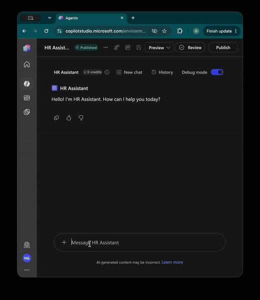
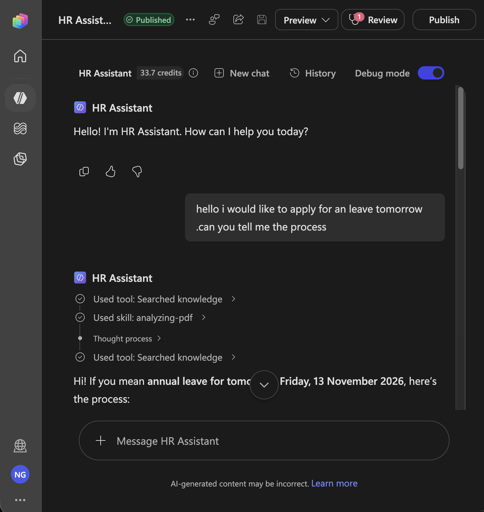
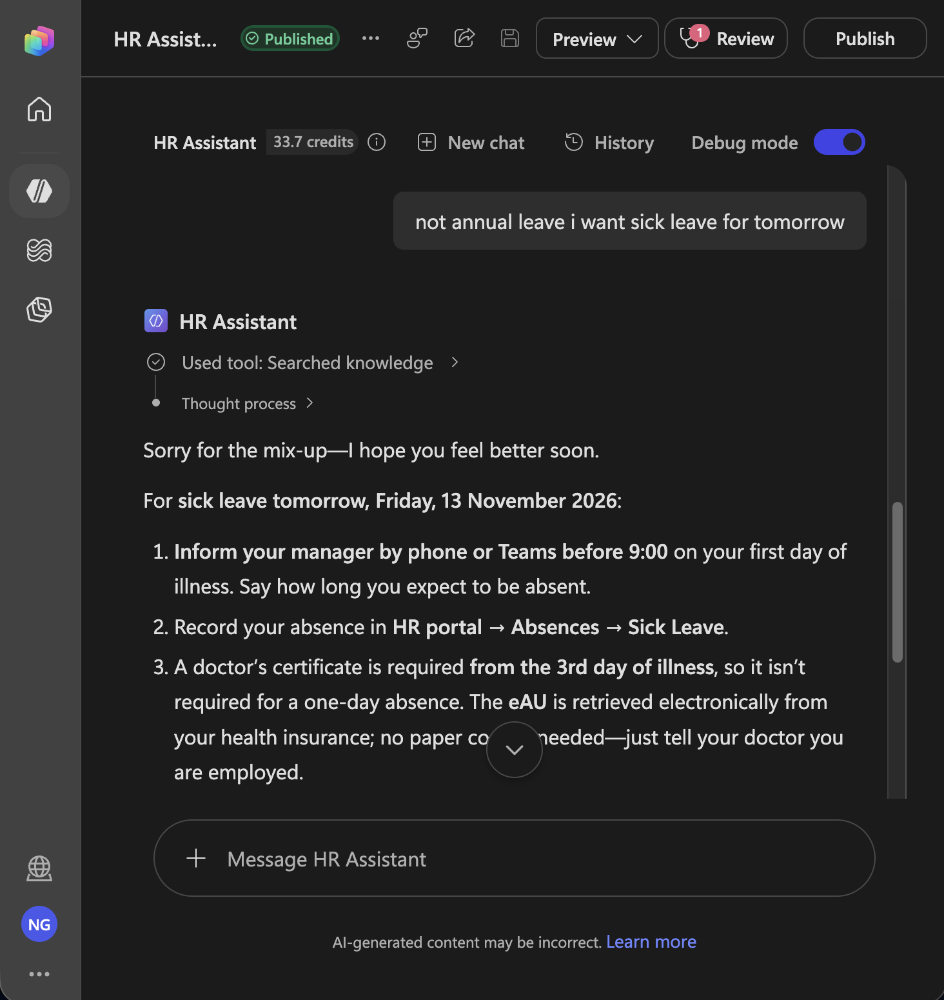

# HR Assistant – Microsoft Copilot Studio Agent

An HR self-service agent built in **Microsoft Copilot Studio**. Employees ask HR questions in natural language (English or German) and the agent answers **only from the company's HR FAQ**. It can also calculate deadlines and vacation days, draft request emails, create checklists and point to the right contact.

> All company policies, numbers and contacts in this project are **fictional** and were created for demonstration purposes.

## What the agent does
| Capability | Example |
|---|---|
| Answer HR questions | "How many vacation days do I get?" → 30 days full-time, pro rata for part-time |
| Step-by-step guidance | "How do I request time off?" → numbered steps with the HR portal path |
| Calculations | "I work 3 days a week" → 30 × 3 / 5 = 18 vacation days |
| Deadline calculation | "Parental leave starts 1 September" → notify HR by 14 July at the latest |
| Drafting | Drafts a parental leave or vacation request email from the employee's details |
| Checklists | First-day checklist, what to do when sick, offboarding |
| Safe refusal | "What does my colleague earn?" → no personal data, refers to HR |
| Bilingual | Answers German questions in German |

## Demo


*Sped up 2.5×. An employee asks how to apply for sick leave; the agent searches the HR FAQ, explains the steps (inform the manager before 9:00, record the absence in the HR portal, doctor's certificate from day 3) and then drafts a Teams message to the manager with placeholders.* Full-length video (1:29): [demo/hr_assistant_demo.mp4](demo/hr_assistant_demo.mp4)

## How it is built
- **Platform:** Microsoft Copilot Studio (own Microsoft 365 trial tenant, Dataverse environment)
- **Knowledge source:** `knowledge/Employee_HR_FAQ.pdf` – 70 questions in 16 sections, each with full answers and alternative phrasings ("Also asked as") to improve retrieval
- **Instructions:** `agent/instructions.md` – scope, capabilities, answer style and guardrails
- **General web knowledge:** disabled, so the agent cannot answer from the internet
- **Channel:** published to Microsoft Teams + Microsoft 365 Copilot Chat
- **Live agent:** [Open HR Assistant in Microsoft 365 Copilot](https://m365.cloud.microsoft/chat/?titleId=T_b291500b-7ceb-1dd4-4bfb-60a76af96a08&source=copilot-studio) – only works when signed in to the demo tenant, so the agent is shown live via screen share and in the screenshots below

## Evaluation and iteration
I used Copilot Studio's built-in evaluation with 10 auto-generated multi-turn test conversations and two test methods:
- **General quality** (relevance, completeness, use of knowledge sources)
- **Custom classification "Grounded answers check"** (`evaluation/classification_instructions.md`) – does the agent only use FAQ information or correctly say it does not know?

| Run | Change | General quality | Grounded |
|---|---|---|---|
| 1 | First version, answers limited to 1–3 sentences | 2 / 10 | 10 / 10 |
| 2 | Complete-but-concise answers, date calculation, FAQ v3 with full answers | 5 / 10 | 9 / 10 |
| 3 | FAQ v5 (contacts, response times, portal paths), extended instructions | see screenshots | see screenshots |

**What I learned**
- Failures had two different causes: **gaps in the knowledge source** (e.g. what a parental leave request must include) and **agent behaviour** (asking "which year?" instead of calculating the deadline). I fixed them separately – content in the FAQ, behaviour in the instructions.
- Some remaining "fails" are cases where the correct behaviour is to say *"I don't know – please contact HR"*. For an HR agent, not guessing is the intended design.
- The classification judge cannot see the PDF, so it flagged correct contact details as "not grounded". I made the judge instructions more specific about what the FAQ contains.

## Screenshots
Published agent in Copilot Studio – the agent searches the HR FAQ, keeps the conversation context (user corrects "annual leave" to "sick leave"), uses today's date and answers with concrete steps:

| Leave request – agent asks/assumes the leave type | Correction to sick leave – steps, portal path, eAU rule |
|---|---|
|  |  |

## Repository structure
```
agent/        instructions.md            – agent instructions (system prompt)
knowledge/    Employee_HR_FAQ.pdf        – knowledge source
              generate_faq.py            – script that generates the FAQ (LaTeX)
evaluation/   HR_Assistant_Test_Questions.pdf – manual test questions with expected answers
              classification_instructions.md  – custom evaluation criteria
screenshots/  test chat screenshots
demo/         demo video (MP4) and GIF preview
```

## Possible next steps
- Add a tool (Power Automate / Outlook) so the agent can forward unanswered questions to HR automatically
- Connect a SharePoint HR site instead of a PDF
- Use Copilot Studio analytics to find the most frequent unanswered questions and extend the FAQ

---
Built by Navya Geethika Namburi · M.Sc. Information Technology, TH OWL
